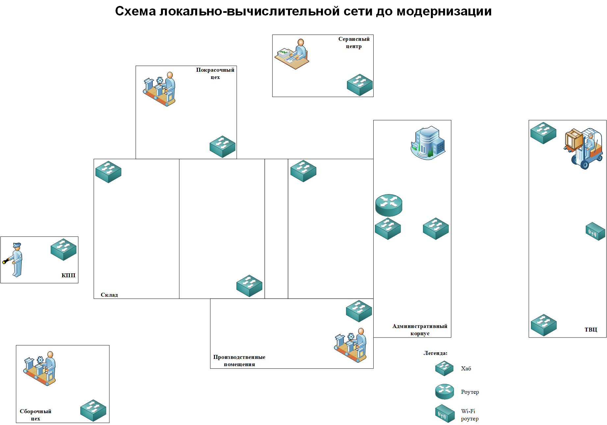
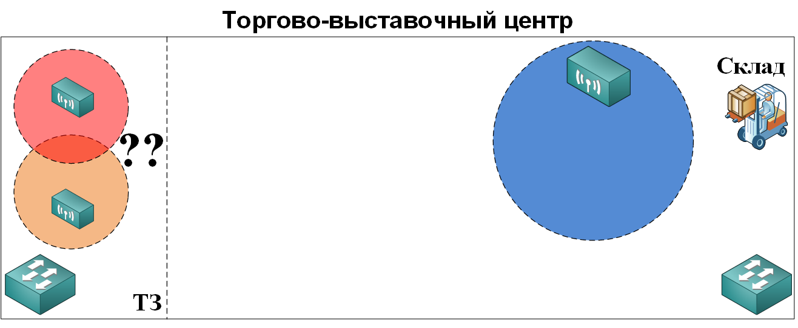
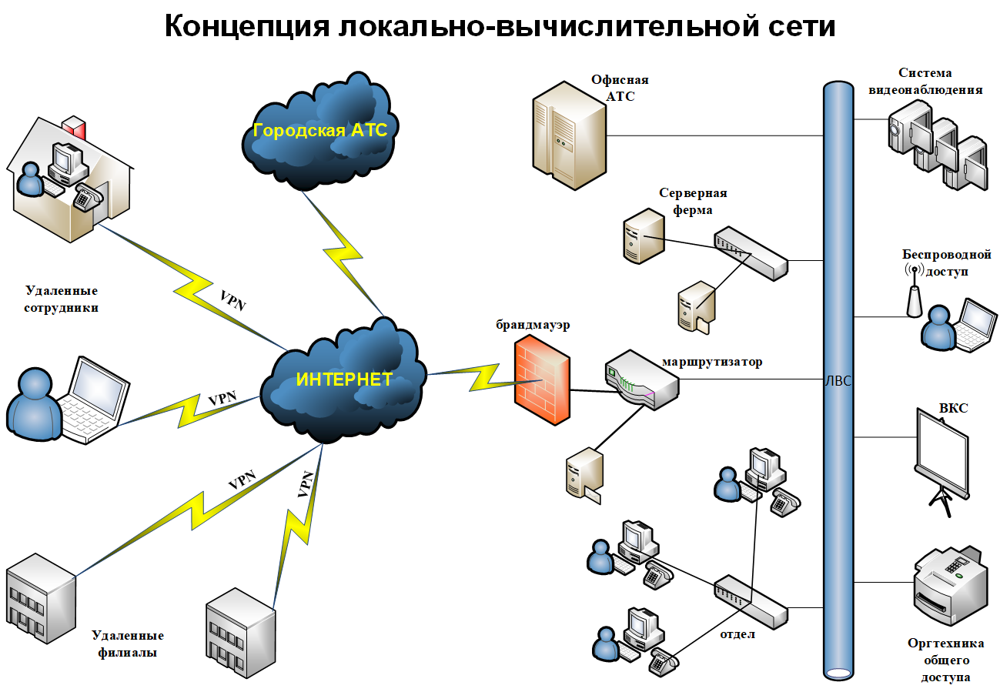
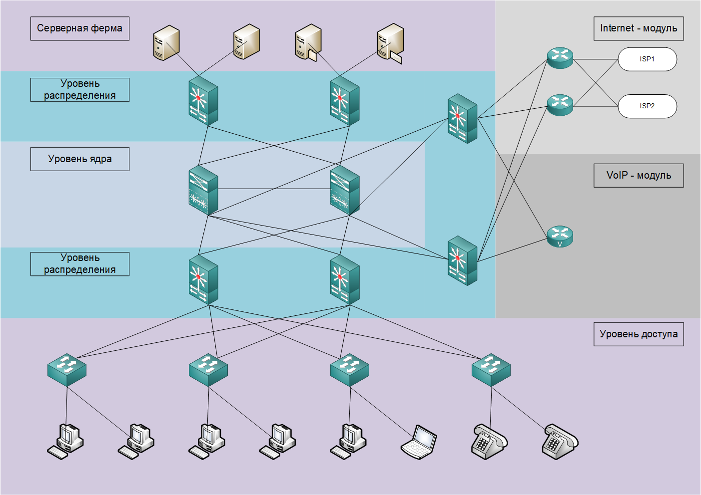
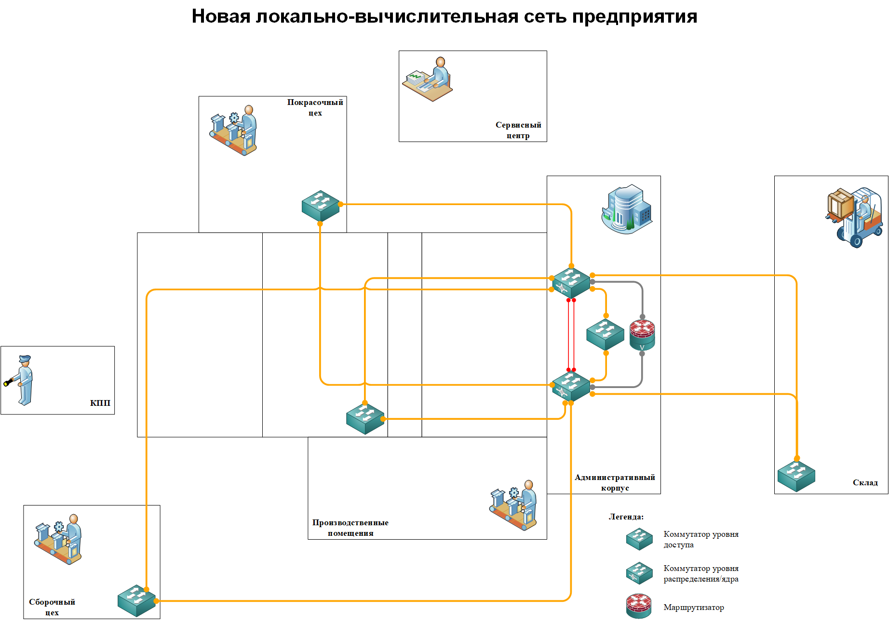

### Как мы модернизировали нашу сеть

Модернизация ЛВС предприятия — сложный и ответственный процесс: ошибка на любом этапе может обернуться простоем и финансовыми потерями.

Далее я поделюсь нашей историей — как команда специалистов несколько лет модернизировала сеть крупного производственного предприятия в Смоленской области.

## Аудит
Первое что необходимо было сделать команде это провести аудит текущей ИТ-инфраструктуры и понять какие компоненты нуждаются в модернизации. Для этого мы начали собирать информацию об используемом сетевом и сервером оборудовании, составе и принципах функционирования системы видеонаблюдения и телефонии. Дополнительно мы собрали сведения о применяемых программных средствах и фактических сценариях его использования.

Работая над сбором необходимой нам информации мы столкнулись с первыми трудностями как же без них. Документация, описывающая текущую сетевую инфраструктуру, была либо неполной или устаревшей, либо отсутствовала совсем. В связи с открывшимися обстоятельствами мы приняли решение, разработать собственную схему текущей сетевой инфраструктуры (так как мы ее видим и понимаем).

Наше решение было вынужденным но не идеальным, так как мы постоянно сталкивались не только с отсутствием необходимой нам документации, но и загадками функционирования той или иной "сетевой сущности" в каком либо здании предприятия.

Например, здание "Торгово выставочного центра" разделено на две секции: "Торговый зал" и "Склад". В ходе первоначального обследования было выявлено что в здании функционирует 5 единиц сетевого оборудования, причем два сетевых устройства (Wi-Fi роутер) попутно выполняли функции "точек доступа" и покрывали определенную складскую зону Wi-Fi сетью. В торговом зале также присутствовал Wi-Fi сигнал, однако установить природу его возникновения с первого раза не удалось.

Работая над схемой текущей сетевой инфраструктуры, мы попутно решали еще одну немало важную задачу - это обследование состояния кабельной инфраструктуры. Наши усилия в этом направлении не были напрасными, так как, такой подход не только позволил нам ответить на вопрос: "Откуда в торговом зале возникал Wi-Fi сигнал?" но и уточнить состав и структуру сетевых компонентов, получить информацию о местах размещения оборудования, условиях его эксплуатации и выявить потенциальные проблемные участки кабельной сети с признаками деградации.

Собрав и обработав необходимую информацию, мы запросили встречу с руководством компании.

## Концепция будущей сети
На встрече с руководством компании, мы хотели не только рассказать о промежуточных результатах нашей работы, но и обсудить черновой вариант концепции будущей сети предприятия. Однако встреча пошла не по плану: из-за одного ключевого момента, предложенная концепция не учитывала дальнейшие планы компании по ее росту. Для руководства этот момент являлся принципиальным основанием для ее модернизации. Выслушав стратегические планы развития компании, мы взяли двухнедельный тайм-аут на корректировку нашей концепции (красной пунктирной линией выделена область, которой не было в первоначальном варианте; финальный же вариант выглядит, так):

## Выбор технического решения
У нас на руках была утвержденная концепция плана модернизации локально-вычислительной сети предприятия — документ, который обеспечивал нас объемом работ на длительное время. Однако в нем не было ничего, что хотя бы в минимальной степени приблизило бы нас к реализации этого плана.

Мы начали с малого, проанализировав результаты аудита, мы пришли к следующему выводу:
  - 45% всей кабельной инфраструктуры предприятия имели признаки существенной деградации;
  - сетевое оборудование имело хаотичное беcсистемное размещение по всей площади предприятия;
  - текущая модель построения сети не соответствовала каким-либо современным требованиям.

В связи с вышеизложенным мы приняли решение, что модернизация текущей сетевой инфраструктуры не целесообразна, а лучше всего спроектировать новую сетевую инфраструктуру, отвечающую современным требованиям. За основу мы взяли классическую иерархическую модель сети, состоящую из трех уровней: 
  - уровень доступа (Access Layer) - предоставляет пользователям или устройствам (принтер, сканер, ip-телефон) доступ к сети;
  - уровень распределения (Distribution Layer) - агрегирует/объединяет уровни доступа и предоставляет доступ к различным сервисам;
  - уровень ядра (Core Layer) - агрегирует/объединяет уровни распределения в больших сетях.

Дизайн больших корпоративных сетей, охватывающих два и более зданий, обязывает использовать "Уровень ядра". Но для снижения затрат и общего числа устанавливаемых устройств можно объединить уровень распределения с уровнем ядра (если это позволяют размеры сети и требования к пропускной способности). Что мы собственно и сделали. На уровне распределения мы установили более производительное оборудование, и учли то что размер будущей сети будет не большой всего лишь 5 корпусов. Подбор же оборудования выполнялся с учетом ранее описанной структуры по уровням:
  - на уровне распределения мы установили L3-коммутаторы компании Cisco (Cisco Catalyst WS-C3850-12XS-S, Layer3, 12 портов 10GE SFP+);
  - на уровне доступа мы установили L2-коммутаторы компании Cisco (Cisco Catalyst WS-C2960X-48FPD-L, Layer2, 48 портов 10/100/1000Base-T, 2 порта 10 GE SFP+, PoE/PoE+);
  - в качестве маршрутизируемого устройства (edge-устройства) для подключения к сети Интернет использовали маршрутизатор Cisco серии ISR — Cisco ISR 4331-SEC/K9.  

Переложив на схему зданий - классическую иерархическую модель построения сети, мы получили новую локально-вычислительную сеть предприятия:

## Миграция
Этот раздел посвящен тому, как на примере одного из корпусов предприятия, мы выполнили замену устаревшей кабельной инфраструктуры на новую, а также осуществили миграцию пользователей и ИТ-сервисов из старой локально-вычислительной сети в новую.

Мы начали с того, что одно из офисных помещений выделили под новую серверную. Закупили пассивное сетевое оборудование, из которого в последствии начали отстраивать нашу новую локально-вычислительную сеть. В серверном помещении мы разместили и смонтировали коммуникационные шкафы, после чего приступили к монтажу обновленной кабельной инфраструктуры.

За фальштополком потолком мы проложили проволочные кабельные лотки. Через которые в каждое офисное помещение мы протянули новые сетевые соединения из расчета 2 соединения на одно рабочее место: отдельное соединение под пользовательский компьютер и отдельное соединение под телефон. Такая организация рабочего места упростила нам в будущем эксплуатацию и администрирование, но увеличила экономичность решения. Параллельно с прокладкой кабельной инфраструктуры мы закупали новое серверное оборудование. Завершив прокладку новой кабельной инфраструктуры мы начали размещать активное сетевое и серверное оборудование в коммуникационные шкафы. При этом появились следующие трудности: 
   - не было четкого понятия о том, как подружить старую и новую локально-вычислительную сеть между собой;
   - у многих пользователей, которые находились в старой локально-вычислительной сети, отсутствовал доступ к принтерам, сетевым папкам и другим ИТ-ресурсам,  которые располагались в новой сети;
   - перенос определенных ИТ-сервисов из старой сети в новую, был либо практически не возможен, либо частично возможен.

Не решив эти проблемы мы не могли двигаться дальше, так как руководство компании на совещании указало на то что бизнес процессы происходящие в компании категорически нельзя прерывать ни на минуту при модернизации локально-вычислительной сети.  

 
 
 
 
 
 
 
 
 
 
 
 
 
 

На этом пути нам встретилось несколько трудностей.
Во-первых, у многих пользователей переставали работать принтеры. На рабочих станциях некоторых пользователей доступ к принтерам был настроен по конкретному IP-адресу. После переключения принтеров на новый диапазон они получили и новые адреса, а пользователи потеряли к ним доступ. Для решения проблемы на следующий день после миграции мы на половину рабочего дня выделяли одного специалиста поддержки, чтобы он обошел пользователей, которые подверглись миграции, и перенастроил принтеры на использование не IP-адресов, а DNS-имен.

 
 
 
 
 
 
 

Начали мы с того что одно из офисный помещений выделили под новую серверную. Закупили пассивное сетевое оборудование из которого в последствии отстраивали кирпичик за кирпичиком нашу новую локально-вычислительную сеть. После монтажа и размещения коммуникационных шкафов в новом серверном помещении, мы приступили к монтажу новой СКС. 

В этом разделе на примере одного из корпусов предприятия рассмотрен процесс замены устаревшей кабельной инфраструктуры на новую, а также миграции пользователей и ИТ‑сервисов со старой локально‑вычислительной сети на новую.

В этот раз я расскажу о процессе миграции пользователей (более 1600 человек) со старой сети на новую. Всех заинтересовавшихся приглашаю под кат.

В каждом офисном помещении была предусмотрена проектная плотность портов из расчёта 2 точки подключения на рабочее место: отдельный порт для пользовательского компьютера и отдельный порт для телефона. Такая организация упростила эксплуатацию и администрирование, но увеличила потребность в кабельной и коммутационной инфраструктуре, снижая экономичность решения.

В каждое офисное помещение мы проводили необходимое количество сетевых соединений  из расчета на одно рабочее место 2 соединения. Одно соединение предназначалось под пользовательский компьютер, а другое соединение под телефон. Такая схема была очень удобной в плане эксплуатации, но не экономичной. 

Параллельно с прокладкой новой СКС мы закупли новое серверное оборудование.   

Мы начали с того что выделили одно из офисный помещений под новую серверную. Закупили пассивное сетевое оборудование из которого в последствии начали выстраивать нашу новую локально-вычислительную сеть. Параллельно с прокладкой СКС мы закупили новое серверное оборудование.   

 
 
 
 
 
 
 
 
 
 
 
 
 
 
 

Про анализировав все подводные камни, саму концепцию мы пришли к выводу что мы не будем модернизировать существующую сеть а построим абсолютно новую с учетом самых лучших практик. Мы остановились на классической схеме построения сетей: "уровень ядра" -> "уровень распределения" -> "уровень доступа".
================= НЕ ГОТОВО ================

У нас на руках была утвержденная концепция плана модернизации локально-вычислительной сети предприятия - документ, который обеспечивал нас работой на длительное время. Однако в нем не было ничего, хоть 

Вариант 1 (нейтрально-деловой):
У нас на руках была утверждённая концепция плана модернизации локально-вычислительной сети предприятия — документ, который обеспечивал нас работой на длительное время. Однако в нём не было ничего, что хоть в минимальной степени приблизило бы к реализации этого плана.

Вариант 2 (короче):
У нас была утверждённая концепция модернизации ЛВС, обеспечивавшая объём работ на длительный срок. Но в ней отсутствовали элементы, которые позволили бы приблизиться к реализации плана.

Вариант 3 (более мягко по тону):
У нас на руках была утверждённая концепция плана модернизации ЛВС, рассчитанная на длительный срок. При этом в документе не было достаточных исходных данных, чтобы продвинуться к практической реализации.

Таким образом, проведённые мероприятия обеспечили формирование целостного представления о текущем состоянии ИТ-инфраструктуры и создали основу для дальнейшего планирования модернизации.
 

 
 
 
 
 
 

(в дальнейшем собранная сопутствующая информация использовалась при проектировании сетевой инфраструктуры).

отсутствовала практически, либо не соответствовала хоть какому-то    

се  , хоть в каком либо приближении   и4♦ описывающая текущую   

стол столькнули с 

,    

Собрать информацию обо всем используемом   о    не только 

 
 
 
 
 
 
 
 

В качестве вводных, имеется довольно крупная сеть на базе решения Cisco, эксплуатируемая уже более 10 лет и состоящая из:

    1 348 зданий и сооружений;

    10 030 разнотипных точек доступа производства, начиная с откровенного старья AIR-LAP1131G, AIR-LAP1041N (около 88% от общего числа), заканчивая вполне себе неплохими CAP1602I, CAP2602I, CAP1702I, AP1832I;

    WISM1, WISM2, WLC 8540.

За более чем 10 лет эксплуатации кабельные линии стали приходить в негодность в результате различных перепланировок и капремонтов. Большое количество точек доступа и инжекторов питания стало выходить из строя, что вкупе с тенденцией роста потребления трафика привело к постоянным жалобам на качество сервиса.

С учетом сроков и возможностей бюджета решено, что на первом этапе модернизации будут подвергнуты сети в 589 зданиях, решение о дальнейшей модернизации будет принято после анализа последствий текущей модернизации. 

Сформулированы следующие задачи:

    замена вышедших из строя и устаревших точек доступа новыми и современными;

    обеспечение покрытия дополнительных зданий и помещений;

    замена коммутаторов доступа и инжекторов питания на PoE коммутаторы;

    реконструкция существующих кабельных линий связи и формирование новых от активного оборудования до точек доступа.

 
 
 
 
 
 
 
 

На начальном этапе работы команде необходимо было провести аудит текущей ИТ-инфраструктуры организации и определить, какие компоненты требуют модернизации. Для этого было выполнено обследование и сбор данных об используемом сетевом и серверном оборудовании, составе и принципах функционирования системы видеонаблюдения и телефонии, а также проведена оценка состояния кабельной инфраструктуры. Дополнительно были собраны сведения о применяемых программных средствах и фактических сценариях их использования.

В процессе сбора информации возникли первые трудности: документация, описывающая текущую сетевую инфраструктуру, либо была неполной и частично устаревшей, либо отсутствовала. В результате было принято решение разработать собственную схему текущей сетевой инфраструктуры, отражающую реальное состояние системы на момент обследования.

Разработка схемы осуществлялась параллельно с обследованием кабельной инфраструктуры. Такой подход позволил не только уточнить состав и структуру сетевых компонентов, но и получить информацию о местах размещения оборудования, условиях эксплуатации, а также выявить потенциальные проблемные участки кабельной сети.

Таким образом, проведённые мероприятия обеспечили формирование целостного представления о текущем состоянии ИТ-инфраструктуры и создали основу для дальнейшего планирования модернизации.
